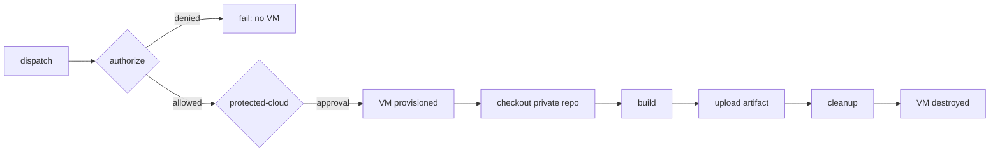
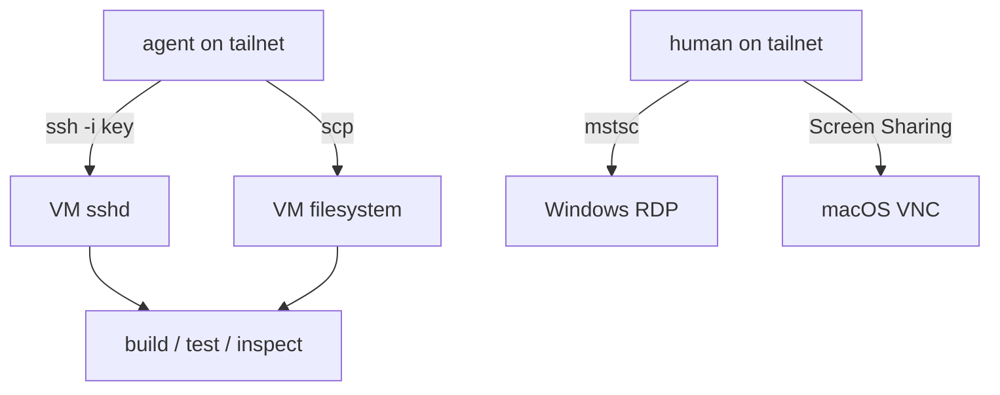

# Diagrams

ASCII for reading in a terminal, Mermaid for rendering.

## 1. System overview

```
                     +--------------------------------------+
                     |        PUBLIC REPO                   |
                     |  codebox1230/my-builder              |
                     |  (workflows only - no source code)   |
                     +---------------+----------------------+
                                     | dispatch
                     +---------------v----------------------+
                     |         GITHUB CONTROL PLANE         |
                     |  secrets sealed -> job memory        |
                     |  runner queue, artifact storage      |
                     +---------------+----------------------+
                                     | job assignment (outbound)
              +----------------------+-----------------------+
              v                      v                       v
      +---------------+     +---------------+      +---------------+
      |  ubuntu VM    |     |  windows VM   |      |   macOS VM    |
      |  build + SSH  |     | build+RDP+SSH |      | build+VNC+SSH |
      +-------+-------+     +-------+-------+      +-------+-------+
              |                      |                      |
              +----------------------+----------------------+
                                     | WireGuard tunnel (outbound only)
                       +-------------v--------------+
                       |      YOUR DEVICES          |
                       |  agent: ssh / scp          |
                       |  human: mstsc / ScreenShr  |
                       +----------------------------+
```

## 2. Headless build sequence

```
  t+0s    dispatch
          |
  t+2s    authorize job      actor check
          |
  t+8s    environment gate   (protected-cloud approval)
          |
  t+15s   VM provisioned     Azure VM boots, toolchain present
          |
  t+25s   checkout           token decrypts -> clone private repo
          |
  t+40s   build              your toolchain runs
          |
  t+90s   upload artifact    to GitHub storage
          |
  t+95s   cleanup            rm source, VM destroyed
```

## 3. Interactive session sequence

```
  dispatch
      |
      v
  authorize + environment gate
      |
      v
  VM boots --> Tailscale joins tailnet (ephemeral node)
                    |
                    |-> SSH key installed  --> agent path (non-interactive)
                    |
                    +-> RDP/VNC enabled   --> human path (GUI)
                             |
                             v
                    you connect, work, verify
                             |
                             v
              cleanup: source removed, tunnel closed, VM destroyed
```

## 4. Secret lifecycle

```
   you                    GitHub                    VM
   |                       |                       |
   | gh secret set X      |                       |
   |---------------------->|                       |
   |  (sealed with repo   |                       |
   |   public key on       |                       |
   |   your side)         |                       |
   |                       |<-- job starts        |
   |                       |---- decrypt -------->|
   |                       |    env var in job    |
   |                       |    memory only       |
   |<-- GET /secrets ------|                      |
   |  names + timestamps   |                      |
   |  (NO value field)     |                      |
   |                       |                       |
   |<-- job ends ---------------------------------|
   |  secret ceases to exist outside job memory   |
```

## 5. Two-agent handoff

```
  +--------------+                        +------------------+
  | Agent A      |  .cloud-build/          | Agent B (cloud)  |
  | (edits code) |  request.json  -------->| dispatches build |
  |              |                        | on cloud VM      |
  |              |<-------- result.json ---| downloads artifacts|
  |              |  .cloud-build-artifacts/|                  |
  +------+-------+                        +------------------+
         | commit + push (cloud only sees pushed state)
         v
   private repo --> VM clones pushed commit
```

## 6. Runner cost comparison

```
  build minutes (public repo)      Azure compute (your own VM)
  ---------------------------       -------------------------
  FREE, unlimited                   Spot VM ~90% off
  no setup                          terraform + cloud-init
  no persistence                    snapshot, warm cache, custom images
  destroyed every job               you control the lifecycle
  4 vCPU / 16 GB / 145 GB           4-16 core / 16-64 GB / 128 GB+
```

## 7. Access surface (Windows session)

```
   port 3389 (RDP)  --> TermService --> NLA required --> Builder account
   port 22   (SSH)  --> sshd --------> key auth (SSH_PUBKEY) --> Builder
   port 5900 (VNC)  --> only on macOS session

   all reachable ONLY via the tailnet (100.64.0.0/10)
   zero inbound from the public internet
```

## 8. Android screen session

```
  +--------------------------------------------------------------+
  |  ubuntu-24.04 runner (one long-lived job)                    |
  |                                                              |
  |   clone private repo -> build APK -> create AVD -> boot (KVM) |
  |   -> install APK -> launch app -> three-button nav           |
  |                                                              |
  |   +---------------------------+                              |
  |   |  emulator (headless)      |                              |
  |   |  ADB on 127.0.0.1:5037    |  <-- loopback only          |
  |   +-------------+-------------+                              |
  |                 |                                            |
  |   sshd (22) + socat (5555) --- keys only                     |
  +-----------------|--------------------------------------------+
                    | WireGuard (outbound only)
      +-------------v--------------+
      |  YOUR DEVICES (tailnet)   |
      |   adb connect <ip>:5555   |
      |   scrcpy / phone browser  |
      +----------------------------+
```

The device is never published to the internet. ADB listens on the runner's
loopback; the agent either runs `adb` *on the far side of SSH*, or republishes
adbd on the tailnet with `socat` and connects to it directly. The direct route
is the one that stays usable for scrcpy - an SSH port-forward stalls video
while the process stays alive.

## Mermaid: build graph



## Mermaid: agent access


